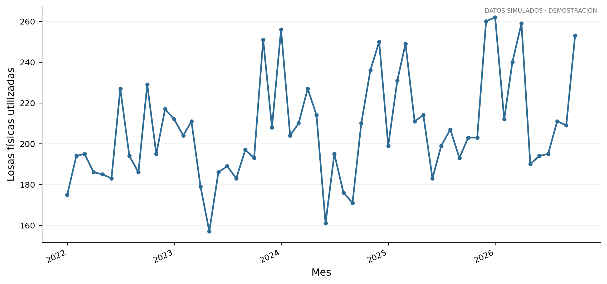
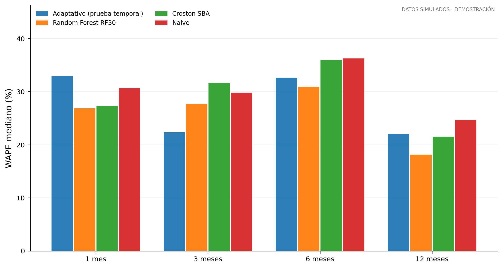

# Pronóstico de demanda de materiales con Random Forest (RF30)

**Proyecto académico | Maestría en Inteligencia de Negocios y Ciencia de Datos | 2026**  
**Autor:** Miguel Angel Tapia Caluqui

## Resumen

Este repositorio presenta una **adaptación académica y pública** de la metodología desarrollada en la investigación *«Modelo predictivo de demanda de materiales para apoyar la planificación de compras mediante Random Forest»*. El objetivo es estimar la utilización mensual de losas físicas (slabs) por material y ofrecer una señal cuantitativa útil para la planificación de compras.

Se comparan un **Random Forest global con 30 árboles** y métodos de referencia mediante **backtesting de origen móvil**, respetando la secuencia temporal. Los horizontes evaluados son 1, 3, 6 y 12 meses, con indicadores **MAE, RMSE, WAPE y Bias**. La alternativa adaptativa escoge un método por material y horizonte con base en evaluación histórica.

> **Alcance de publicación:** este repositorio incluye código estructurado, documentación y datos **100% simulados**. No incluye la base operacional de la empresa, nombres de constructores reales, trabajos, precios ni reglas privadas de extracción. **Por tanto, no reproduce automáticamente las cifras de la tesis**; documenta e ilustra la metodología con un pipeline funcional. Véase [procedencia y limitaciones](docs/procedencia_y_limitaciones.md).

## Objetivo general

Desarrollar y validar un enfoque de pronóstico de utilización de materiales, fundamentado en Random Forest Regression y la comparación con métodos de referencia, para apoyar decisiones de planificación de compras sin convertir la predicción en una orden automática.

## Pregunta de investigación

¿En qué medida un enfoque predictivo que incorpore Random Forest y modelos alternativos puede anticipar la utilización de los materiales de mayor consumo y proporcionar información cuantitativa para priorizar decisiones de compras?

## Proceso metodológico

1. **Comprensión del problema:** diferenciar necesidad solicitada, material asignado y material nuevo.
2. **Calidad y preparación:** validar fechas y campos, asociar eventos FULL/remnant al ID físico base y evitar doble conteo.
3. **Exploración:** consolidar a nivel material-mes, analizar concentración, variabilidad e intermitencia.
4. **Ingeniería de variables:** rezagos de hasta 12 meses, ventanas móviles, tendencia, uso de remanentes y calendario.
5. **Modelado:** Random Forest RF30 y referencias Naive, medias móviles, suavizamiento y Croston SBA.
6. **Evaluación:** reentrenar en orígenes históricos usando sólo información disponible, separar horizonte puntual y acumulado y medir WAPE/MAE/RMSE/Bias.
7. **Aplicación:** priorización y revisión de excepciones; conciliación posterior con inventario, órdenes abiertas, tiempos de entrega y costos.

El diseño se explica con más detalle en [Metodología](docs/metodologia.md) y [Diccionario de datos](docs/diccionario_datos.md). Para publicar consulta [Guía de GitHub](docs/guia_publicacion_github.md).

## Estructura del repositorio

```text
Pronostico_Demanda_Materiales_RF30/
├── README.md
├── pyproject.toml
├── requirements.txt
├── requirements-dev.txt
├── .gitignore
├── .github/workflows/validacion.yml
├── notebooks/
│   └── 01_analisis_y_pronostico_RF30.ipynb
├── src/material_forecasting/
│   ├── config.py          # Parámetros del experimento
│   ├── datos.py           # Validación, fechas y panel mensual
│   ├── ejemplo.py         # Generación de datos artificiales
│   ├── modelos.py         # Variables, métodos clásicos y RF30
│   ├── evaluacion.py      # Backtesting, métricas y selección
│   ├── graficos.py        # Siete figuras demostrativas
│   ├── pipeline.py        # Ejecución integral
│   └── cli.py             # Interfaz de consola
├── docs/
│   ├── metodologia.md
│   ├── diccionario_datos.md
│   └── procedencia_y_limitaciones.md
├── data/
│   ├── README.md
│   └── simulada/eventos_simulados.csv
├── figuras_demo/         # Figuras generadas exclusivamente con simulaciones
├── scripts/
│   ├── generar_datos_demo.py
│   └── ejecutar_demo.py
└── tests/                # Pruebas de integridad y temporalidad
```

## Instalación y ejecución

**Requisitos:** Python 3.10 o posterior. Desde la carpeta principal:

```bash
python -m venv .venv
# Windows: .venv\Scripts\activate
# macOS / Linux: source .venv/bin/activate
pip install -e ".[dev]"
```

Ejecutar la demostración completa con la base simulada incluida:

```bash
python -m material_forecasting.cli --datos data/simulada/eventos_simulados.csv --salida outputs/ejecucion_demo
```

Si prefieres crear otra base artificial determinista:

```bash
python -m material_forecasting.cli --datos data/simulada/eventos_simulados.csv --solo-generar
python -m material_forecasting.cli
```

También puedes abrir `notebooks/01_analisis_y_pronostico_RF30.ipynb` en Jupyter o Google Colab, siguiendo las instrucciones de sus primeras celdas. El notebook explica cada etapa en español y ejecuta el mismo motor documentado en `src/`.

**Pruebas automatizadas:**

```bash
python -m pytest -q
```

## Vista previa (simulación)

Las imágenes siguientes se generaron exclusivamente con datos artificiales. **No son resultados de la tesis.**





## Salidas generadas

El comando crea CSV dentro de `outputs/ejecucion_demo/` con: auditoría de datos, panel mensual, backtesting, WAPE puntual y acumulado de la prueba temporal, selección de modelos por material/horizonte y pronósticos mensuales a 12 meses. Se crean **7 figuras PNG y SVG**, todas marcadas como datos simulados. `outputs/` está excluido de Git.

Los gráficos de ejemplo son:

- Utilización física histórica mensual y dependencia entre meses consecutivos.
- Comparación de WAPE puntual entre métodos (orígenes posteriores reservados para prueba).
- Pronóstico mensual agregado y comparativo histórico-pronóstico por material.
- Concentración **histórica** por constructora (no es predicción por cuenta).
- Proxy de material FULL para 3, 6 y 12 meses (no representa compra neta).

## Resultados consignados en la tesis (no recalculados con la demo)

El documento académico, para su corte de **1 de noviembre de 2026**, reporta los siguientes **WAPE medianos de horizonte puntual**:

| Método | 1 mes | 3 meses | 6 meses | 12 meses |
|---|---:|---:|---:|---:|
| Solución adaptativa | 42,89% | 49,08% | 52,47% | 43,77% |
| RF30 puro | 46,89% | 51,30% | 57,65% | 53,12% |
| Croston SBA | 50,97% | 55,98% | 61,48% | 49,26% |
| Naive (último valor) | 50,85% | 59,49% | 65,11% | 49,17% |

**Origen de estas cifras:** tablas de la tesis; **NO son valores obtenidos del CSV sintético de este repositorio ni resultados comprobados mediante este código público**. La cobertura de 12 meses en la tesis es inferior a la de otros horizontes, por lo que se deben interpretar con cautela. El **WAPE mediano acumulado** reportado a 3 meses es **33,31%**, distinto del WAPE de 49,08% correspondiente al tercer mes puntual. La metodología y selección adaptativa del motor original contiene componentes privados adicionales, por lo que **no debe presuponerse equivalencia numérica** con esta adaptación.

## Consideraciones metodológicas

- WAPE expresa `error absoluto / volumen real` y **no equivale a precisión** (`100% − WAPE`).
- Un sesgo positivo representa sobrepronóstico; un sesgo negativo, subpronóstico.
- Se evita entrenar con targets conocidos sólo después de cada origen.
- El modelo puede ser superado por un baseline en algunos materiales; no se obliga a elegir RF30.
- La selección del Top N en este demostrador se realiza para el portafolio definido; un análisis riguroso de estabilidad longitudinal debe recalcular el Top N dentro de cada origen para evitar sesgo de selección.
- Los datos sintéticos tienen más historia que el caso real para permitir una prueba temporal ilustrativa con horizonte completo de 12 meses. **Las métricas demo no generalizan al caso real.**

## Privacidad y uso responsable

Las bases empresariales y las transformaciones internas de notas libres no se publican. El `.gitignore` incluye exclusiones para datos privados y artefactos, pero su uso no sustituye la revisión manual de seguridad antes del primer commit. Para ejecutar con datos autorizados, se requiere un CSV **previamente estructurado y anonimizado** conforme a [esta especificación](docs/diccionario_datos.md).

## Referencia académica

Tapia Caluqui, M. A. (2026). *Modelo predictivo de demanda de materiales para apoyar la planificación de compras mediante Random Forest*. Proyecto de titulación, Maestría en Inteligencia de Negocios y Ciencia de Datos, Universidad de Las Américas.

---

**Estado:** adaptación académica verificable con datos sintéticos. La validación de equivalencia con el motor privado y la publicación de resultados empresariales requieren revisión y autorización independientes.
